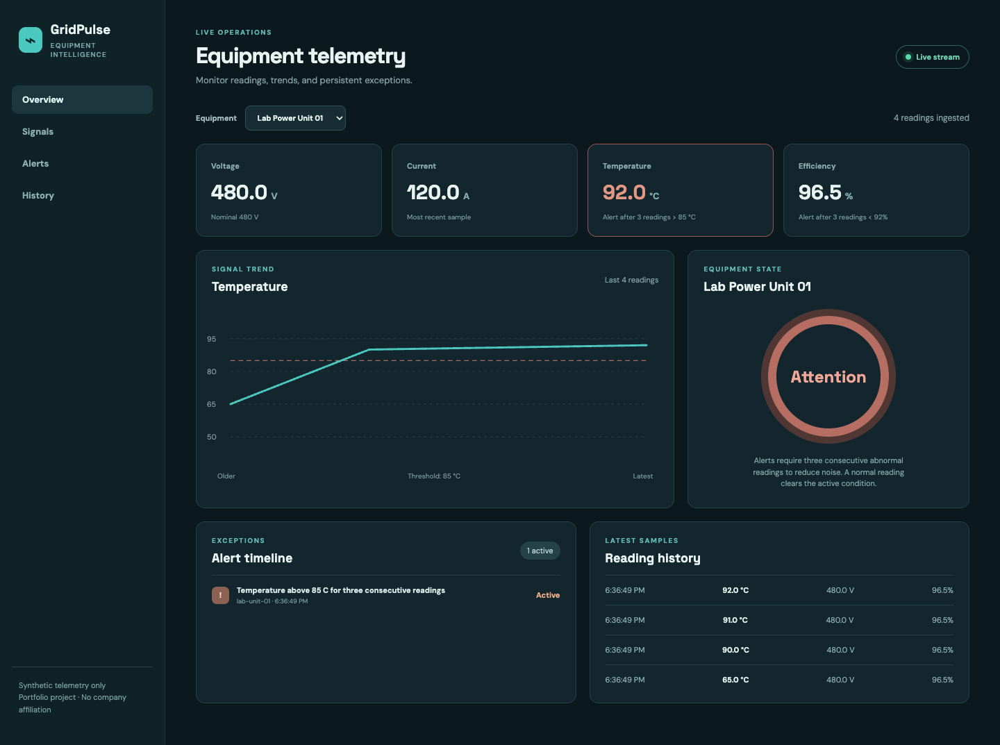

# GridPulse Energy Telemetry
[](https://github.com/tanishq-eradala/gridpulse/actions/workflows/ci.yml)

GridPulse is a synthetic equipment telemetry and reliability portfolio project. It has no affiliation with Amperesand or any employer and uses no real equipment data. A Go service ingests readings, stores them in SQLite, identifies persistent abnormal conditions, broadcasts new readings over Server-Sent Events, and exposes Prometheus-format metrics. A React/TypeScript console shows live trends and alert history.

## What it models

Equipment monitoring needs to distinguish a persistent exception from an isolated noisy reading. GridPulse follows accepted samples through validation, durable storage, alert transitions, live delivery and dashboard recovery. Its educational thresholds are described in the architecture notes.

## Current implementation

- REST ingestion contract with strict JSON validation, equipment lookup, finite-range and timestamp checks, and unique sample IDs. An identical retry is accepted once; reusing an ID with different data returns a conflict.
- SQLite-backed readings and alert history.
- Temperature, voltage deviation, and efficiency checks. An alert opens after **three consecutive** abnormal samples and resolves on a normal sample.
- Server-Sent Events stream for the live UI, with periodic polling as a fallback.
- Synthetic simulator that periodically generates a hot-equipment scenario, followed by normal readings that resolve it.
- Typed React/TypeScript dashboard with a trend chart, latest measurements, live connection state, and alert timeline.
- Prometheus text metrics for reading count, active alerts, and equipment count.
- Go tests for persistent alerts, resolution, duplicate samples, invalid readings, HTTP responses, and event publication.
- Browser verification for ingestion, live SSE updates, alert opening/resolution, retries, equipment selection, polling recovery and 390px/320px layouts.
- GitHub Actions checks for Go race tests, vet, frontend type checking/build and browser workflows.



## Run locally

Requirements: Go 1.22+ (with a C compiler for the SQLite driver), Node.js 24+, npm.

Terminal 1:

```bash
cd backend
go run .
```

Terminal 2:

```bash
cd backend
go run ./cmd/simulator
```

Terminal 3:

```bash
cd frontend
npm ci
npm run dev
```

Open `http://127.0.0.1:5174`. The API runs at `http://localhost:8090`. The simulator sends one sample per second and produces a hot period every 30 samples. For a faster demo, run `go run ./cmd/simulator -interval 200ms`.

## API contract

| Method | Path | Purpose |
| --- | --- | --- |
| GET | `/api/equipment` | Synthetic equipment catalog |
| POST | `/api/readings` | Ingest one measurement |
| GET | `/api/readings?equipmentId=...&limit=60` | Recent readings |
| GET | `/api/alerts` | Active and historical alerts |
| GET | `/api/summary` | Dashboard counts |
| GET | `/api/stream` | Live Server-Sent Events |
| GET | `/metrics` | Prometheus-format metrics |

## Engineering decisions and next work

See [docs/architecture.md](docs/architecture.md). The service uses a local database and synthetic data; it is not deployed or validated on physical equipment.

## Verification

```bash
cd backend
go test -race ./...
go vet ./...
cd ../frontend
npm ci
npm run build
cd ..
python -m pip install -r tests/requirements.txt
python -m playwright install chromium
python tests/run_workflows.py
```

The browser runner starts the API and frontend on separate test ports, uses a temporary database and stops both servers afterwards. Go and npm must be on PATH. Use `--channel chrome` for an installed Chrome, or `--api-port`/`--web-port` to choose free ports. The API supports `GRIDPULSE_ADDR` and one additional exact `GRIDPULSE_ALLOWED_ORIGIN`; the frontend supports `VITE_API_URL`.

The local browser suite passes 15 checks. Screenshots and the detailed report are in [docs/screenshots/verification.json](docs/screenshots/verification.json). These checks do not establish sustained ingest capacity, physical-equipment accuracy or complete accessibility compliance.
